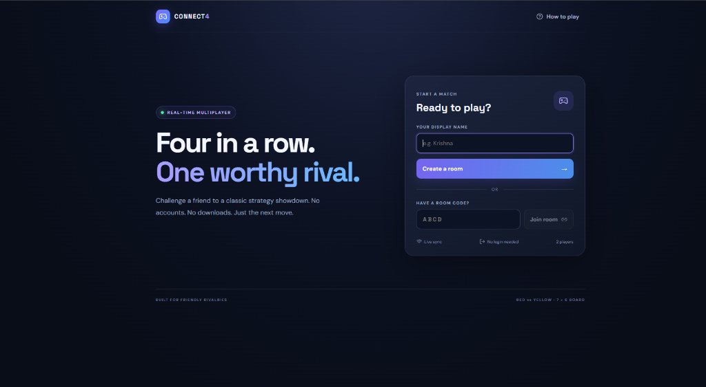
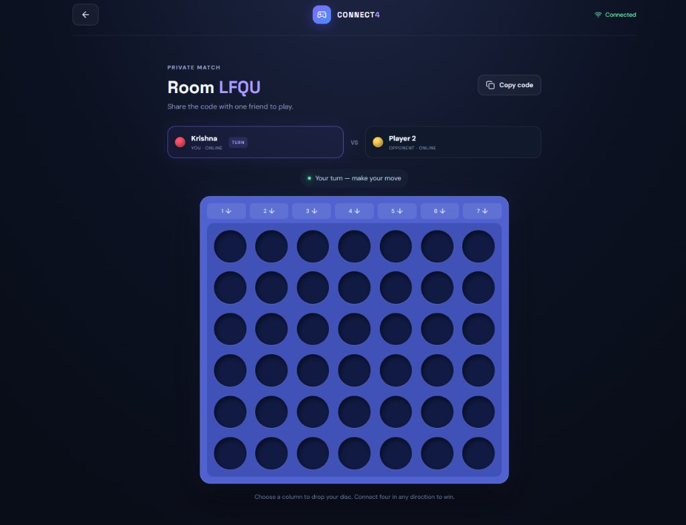

# 🎮 Connect4 Arena — Real-Time Multiplayer Gaming Platform

> **Four in a row. One worthy rival.**  
> A sleek, fast, real-time multiplayer Connect 4 game built with React, Node.js, TypeScript, and Socket.IO. No accounts. No downloads. Just share a room code and make your move.

---

## 📸 Previews

| Lobby & Matchmaking | In-Game Board |
| :---: | :---: |
|  |  |

---

## ✨ Features

- **⚡ Real-Time Gameplay**: Seamless state synchronization and instant move updates powered by Socket.IO WebSockets.
- **🔑 Room Code Matchmaking**: Create a private room in one click and share a unique 4-letter code with a friend. No login or registration required.
- **🛡️ Authoritative Game Server**: The backend validates every move, prevents out-of-turn play, detects wins across horizontal, vertical, and diagonal vectors, and manages draw conditions.
- **🔄 Smart Reconnection**: Players who get disconnected or refresh the page have a 60-second grace period to resume their seat seamlessly using secure local session tokens.
- **🤝 Mutual Rematch**: Both players can vote to play again, resetting the board without leaving the room.
- **🎨 Modern Dark UI**: Polished glassmorphism dark aesthetic, live turn badges, responsive layouts, and smooth drop interactions.

---

## 🛠️ Tech Stack

### Frontend (`client/`)
- **Framework**: [React 18](https://react.dev/) + [TypeScript](https://www.typescriptlang.org/)
- **Bundler & Dev Server**: [Vite](https://vitejs.dev/)
- **Icons**: [Lucide React](https://lucide.dev/)
- **Real-Time Client**: [Socket.IO Client](https://socket.io/)

### Backend (`server/`)
- **Runtime**: [Node.js](https://nodejs.org/) (ES Modules)
- **Framework**: [Express](https://expressjs.com/) + [TypeScript](https://www.typescriptlang.org/)
- **WebSockets**: [Socket.IO](https://socket.io/)
- **Dev Execution**: [tsx](https://github.com/privatenumber/tsx)

---

## 📁 Project Structure

```text
connect4-multiplayer/
├── docs/
│   └── images/              # Preview screenshots
├── client/                  # Frontend application
│   ├── src/
│   │   ├── App.tsx          # Main game UI & lobby flow
│   │   ├── main.tsx         # React root
│   │   ├── socket.ts        # Socket.IO connection & event handlers
│   │   ├── styles.css       # Clean modern CSS
│   │   └── types.ts         # Shared client types
│   ├── .env.example         # Example client env variables
│   ├── index.html           # HTML template
│   ├── package.json         # Client dependencies & scripts
│   ├── tsconfig.json        # TypeScript configuration
│   └── vite.config.ts       # Vite configuration with socket proxy
├── server/                  # Backend service
│   ├── src/
│   │   ├── game/
│   │   │   └── engine.ts    # Board state & win detection logic
│   │   ├── rooms/
│   │   │   └── manager.ts   # Room lifecycle, seats, and reconnection tokens
│   │   └── index.ts         # Express & Socket.IO server entry point
│   ├── .env.example         # Example server env variables
│   ├── package.json         # Server dependencies & scripts
│   └── tsconfig.json        # Server TypeScript configuration
├── .gitignore               # Git ignore rules
└── README.md                # Project documentation
```

---

## 🚀 Getting Started Locally

### Prerequisites
- **Node.js** 20.x or higher
- **npm** 10.x or higher

### 1. Backend Setup

```bash
cd server
npm install
cp .env.example .env
npm run dev
```

The backend server starts on `http://localhost:3001` (Health check: `http://localhost:3001/health`).

### 2. Frontend Setup

In a new terminal window:

```bash
cd client
npm install
cp .env.example .env
npm run dev
```

Open `http://localhost:5173` in your browser.

---

## ⚙️ Environment Variables

### Backend (`server/.env`)

| Variable | Default | Description |
| :--- | :--- | :--- |
| `PORT` | `3001` | Port on which the Express & Socket.IO server listens |
| `CLIENT_ORIGIN` | `http://localhost:5173` | Allowed CORS origins (comma-separated list for production) |
| `SERVE_CLIENT` | `false` | When `true`, serves static files from `client/dist` |

### Frontend (`client/.env`)

| Variable | Default | Description |
| :--- | :--- | :--- |
| `VITE_SERVER_URL` | `http://localhost:3001` | URL of the backend Socket.IO server |

---

## 🌐 Deployment Guide

### Frontend (e.g. Vercel)
1. Import the repository on [Vercel](https://vercel.com/).
2. Set the **Root Directory** to `client`.
3. Add the Environment Variable:
   - `VITE_SERVER_URL` = `https://your-backend-service-url`
4. Deploy!

### Backend (e.g. Render / Railway)
> **Note**: Because Connect 4 uses persistent WebSockets and in-memory room management, deploy the backend to a platform with persistent container hosting such as [Render](https://render.com/) or [Railway](https://railway.app/).

1. Create a new **Web Service** on Render and point it to the repository.
2. Configure:
   - **Root Directory**: `server`
   - **Build Command**: `npm install && npm run build`
   - **Start Command**: `npm start`
3. Add Environment Variables:
   - `NODE_ENV` = `production`
   - `CLIENT_ORIGIN` = `https://your-frontend-domain.vercel.app`
4. Deploy the service and use its public URL as `VITE_SERVER_URL` in your frontend.

---

## 🎯 How to Play

1. **Player 1 (Host)** enters their display name and clicks **Create a room**.
2. A unique **4-letter room code** (e.g. `LFQU`) is generated.
3. Player 1 shares the code with Player 2.
4. **Player 2 (Challenger)** enters the code under **Have a room code?** and clicks **Join room**.
5. Discs drop by selecting any of the 7 column buttons (`1 ↓` to `7 ↓`).
6. The first player to connect **4 discs in a line** (horizontal, vertical, or diagonal) wins!

---

## 📄 License

This project is open-source and available under the [MIT License](LICENSE).
